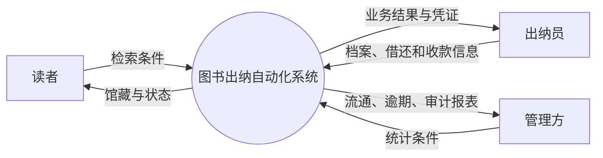
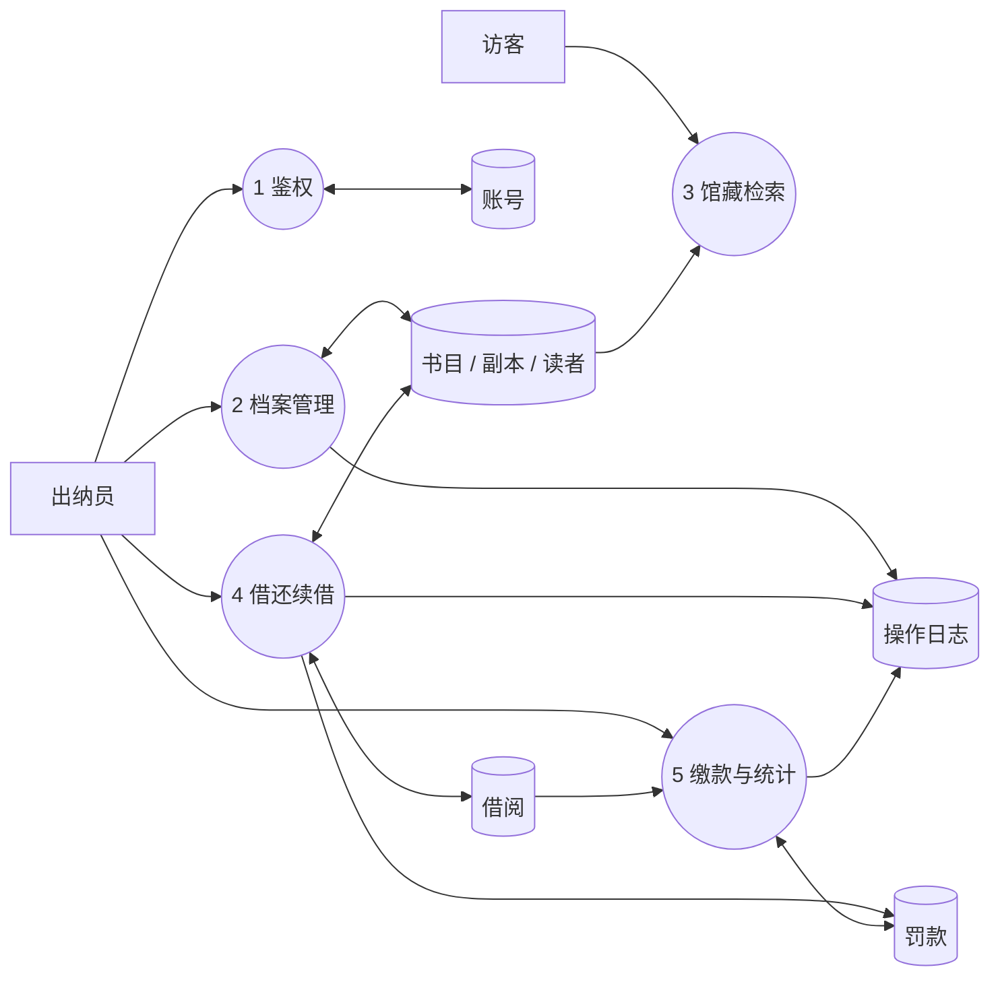
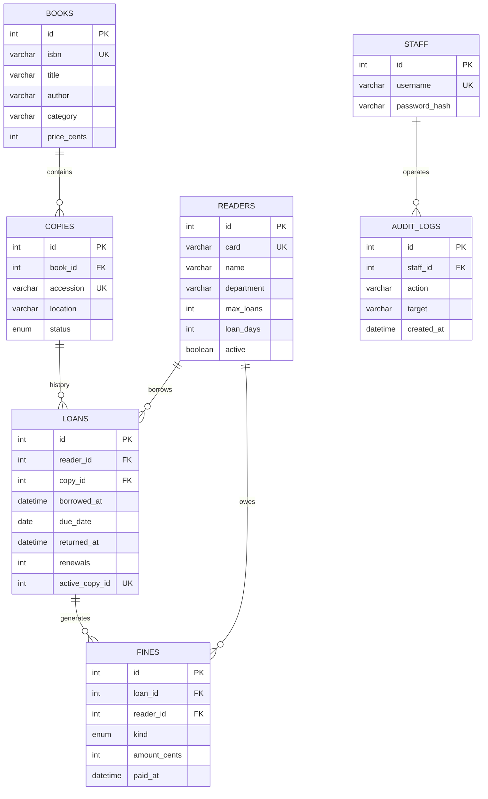
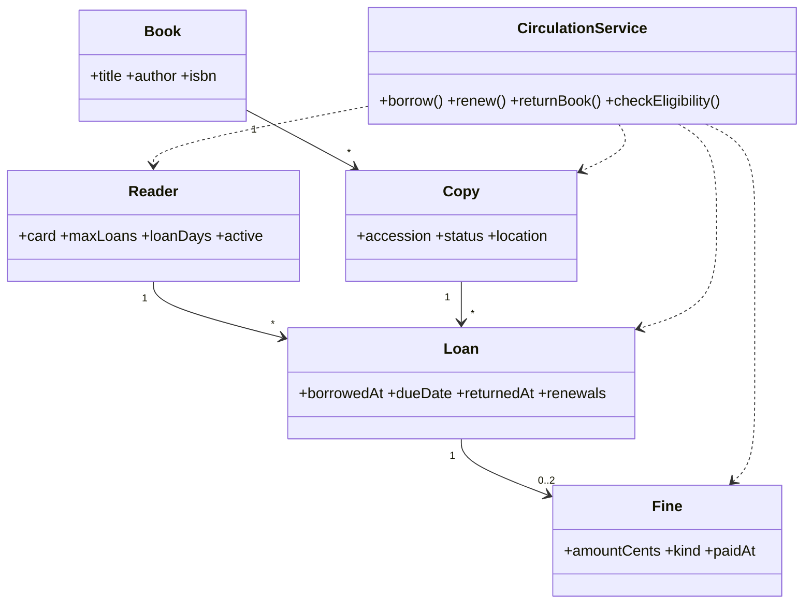
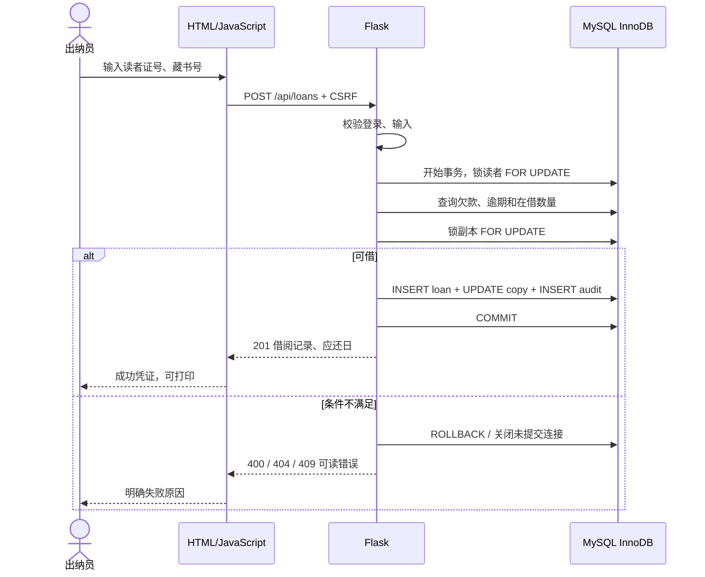
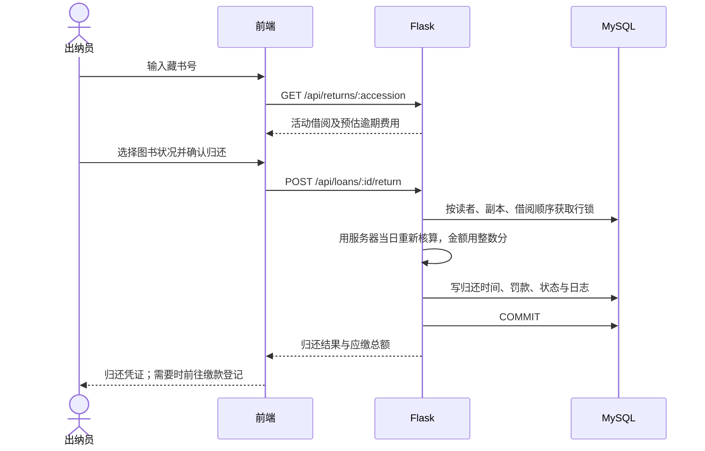
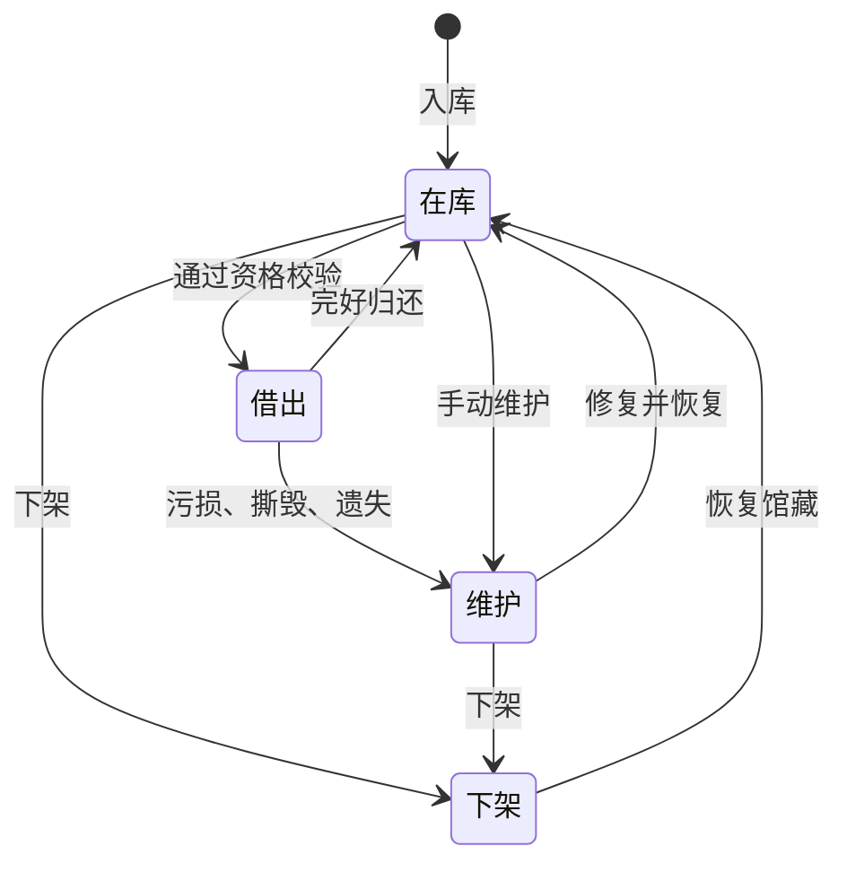
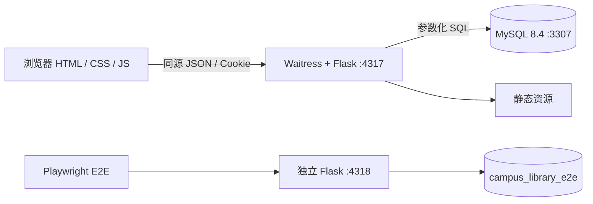

# 校园图书馆图书出纳自动化管理系统

课程：信息系统分析与设计。项目组：肖沁峰、邓皓柏。

## 1. 问题与系统边界

纸质登记造成图书查询慢、借还记录分散、图书去向不清和逾期计算易错。本系统围绕 PPT 的“查、记、追、算”建立出纳台业务闭环。

读者免登录查询书目和副本状态，不接触其他读者资料。出纳员登录后维护馆藏和读者，办理借还续借与缴款。管理方通过同一工作台查看统计。本课程版本只有“访客”和“出纳员”两种权限，管理统计由出纳员账号访问，未虚构额外管理员角色。

不在范围：电子书正文、预约排队、跨馆调拨、自助支付、采购财务、统一身份认证与短信通知。

## 2. 需求可追踪矩阵

| 编号 | 来源 | 需求 | 实现 / 验证 |
|---|---|---|---|
| FR-01 | PPT 第 3、4 页 | 书名和作者部分匹配，看到藏书号与状态 | 公开馆藏检索、筛选、详情 |
| FR-02 | PPT 第 4 页 | 登录与操作留痕 | 会话、CSRF、audit_logs |
| FR-03 | PPT 第 4 页 | 录入、修改、下架、批量导入 | books + copies，CSV 整批事务 |
| FR-04 | PPT 第 4 页 | 读者档案、上限、借期 | readers，停用与欠款拦截 |
| FR-05 | PPT 第 5 页 | 登记借阅并变更副本状态 | reader → copy 行锁；同事务提交 |
| FR-06 | PPT 第 5 页 | 逾期费用与违规归还 | 服务器计费、正常归还 / 维护状态 |
| FR-07 | PPT 第 3 页 | 追踪去向 | 按藏书号查询历史与当前借阅人 |
| FR-08 | PPT 第 4 页 | 续借 | 未逾期、无欠款、限一次 |
| FR-09 | PPT 第 4 页 | 流通与逾期统计 | 近七日趋势、在借率、逾期排行、CSV |

非功能要求：单机可演示，页面支持桌面与手机；个人信息接口必须登录；金额使用整数分；数据库外键与事务保持一致；输入做边界校验，SQL 参数化，用户文字在 HTML 中转义。测试采用真实浏览器，不用前端模拟数据替代数据库。

## 3. 用例图

### 关键用例规格

**借阅 UC-05**：前置条件为出纳员登录。输入读者证号和藏书号。系统锁定读者，检查有效状态、欠款、逾期及上限，再锁定副本检查可借状态。成功后产生借阅记录、自动应还日和日志，副本改为已借出。任何校验失败返回可读错误且不改变业务数据。并发请求由行锁和活动借阅唯一索引保护。

**归还 UC-07**：输入藏书号，查询活动借阅；出纳员检查书籍状况，系统显示预估费用。提交时重新读取并锁定记录，以服务器当天重新核算。归还记录、罚款、副本状态和审计一起提交。完好归还变为在库，污损、撕毁、遗失转为维护。欠费不阻止收书，重复归还被拒绝。

**续借 UC-06**：活动借阅、读者有效、没有欠款及逾期且续借次数为 0。以原到期日加该读者借期，记录次数与审计。次数达到 1、已归还或已逾期均拒绝。

**批量导入 UC-03**：上传 UTF-8 CSV；前端解析带引号字段，服务端逐行验证。任意行无效或唯一约束冲突，整个事务回滚，避免部分成功无法核对。

## 4. 数据流图

### 顶层 DFD

### 一级 DFD

## 5. ER 模型

相较 PPT 的三张核心表，分离书目与副本是为表达“一本书有多册”；分离罚款与审计是为追踪费用和业务变更。核心关系仍然是“读者—借阅记录—图书副本”。完整字段与约束以 `schema.sql` 为准。

关键约束：ISBN、读者证号、藏书号唯一；同一副本只允许一条未归还记录；同笔借阅同类罚款最多一条；不物理删除有历史的副本，以状态下架；金额不使用二进制浮点。

## 6. 领域类图（概念设计）

后端实际采用 Flask 函数式路由，以下是领域关系而非声称实现了对应 Python 类。

## 7. 借阅时序

## 8. 归还时序与状态机

遗失副本不会直接恢复在库，需要处理完赔偿与补书，再由出纳员更新副本状态。

## 9. 架构与事务

数据库隔离级别 READ COMMITTED，借还统一先锁读者、再锁副本、再锁借阅，避免相反加锁顺序；缴款同样先锁读者。SQL 唯一索引补充应用层验证。错误请求不提交事务，连接关闭即回滚。页面不自行决定应还日、逾期天数和费用。

存储时间采用 Asia/Shanghai 的本地时间，所有业务自然日使用同一规则。到期当天允许归还不产生费用，翌日开始计费。前端显示后端时间，不用浏览器本地时区重新解释业务日期。

## 10. 验证与交付边界

失效场景在实现前列于 `设计与验收.md`，验证脚本在 `tests/e2e.cjs`，结果以 `artifacts/e2e-results.json` 为准。浏览器测试生成截图和 trace，可核验完整交互。

版本为单校、单馆、课程演示规模，不声明未经负载测试的并发容量。大型馆藏需服务器分页、全文检索与报表索引优化，生产账号应增加账号管理、登录速率限制、HTTPS 和备份恢复机制。本版本不把这些扩展写成已实现功能。
