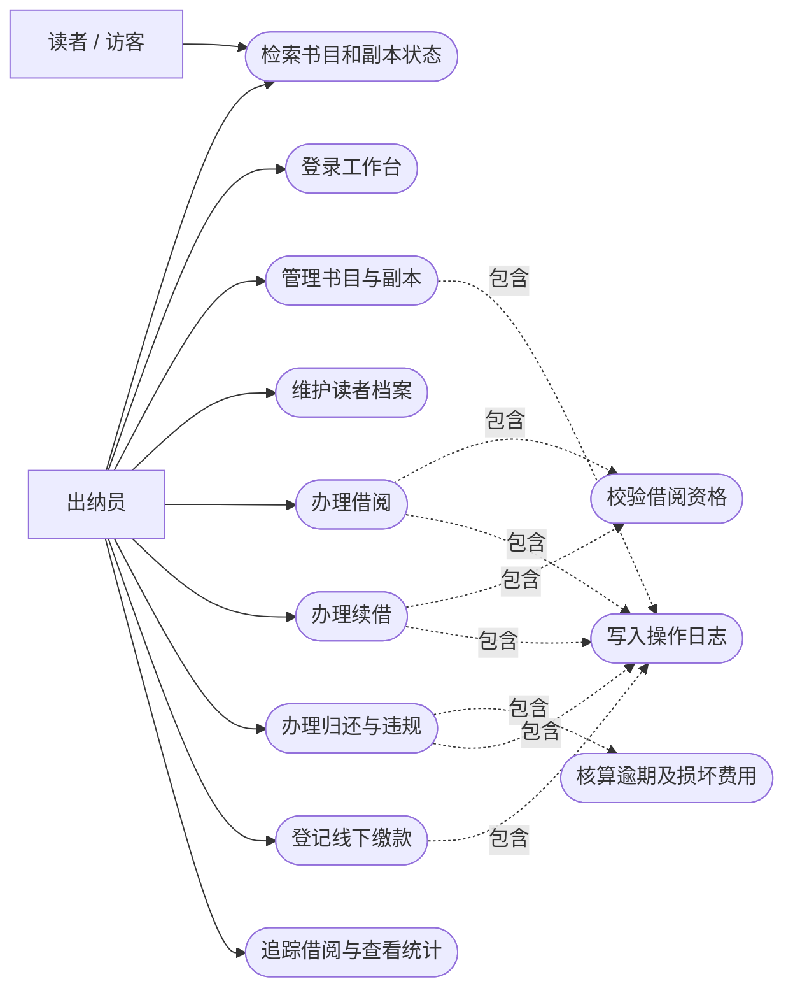
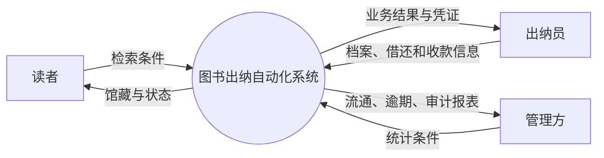
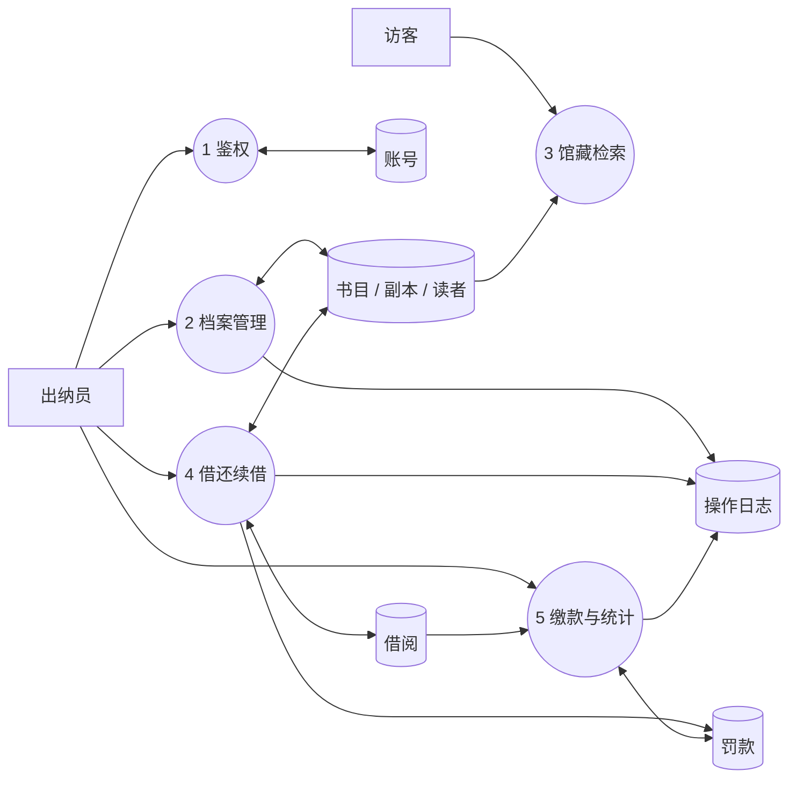
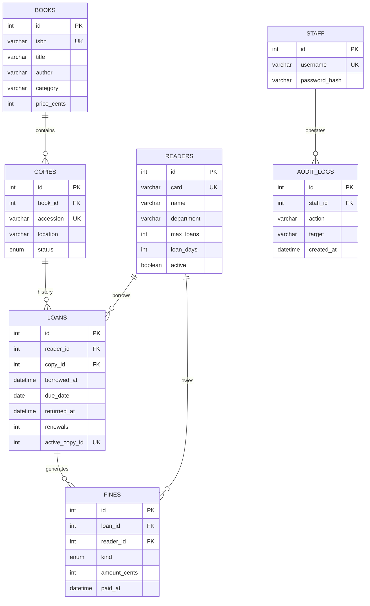
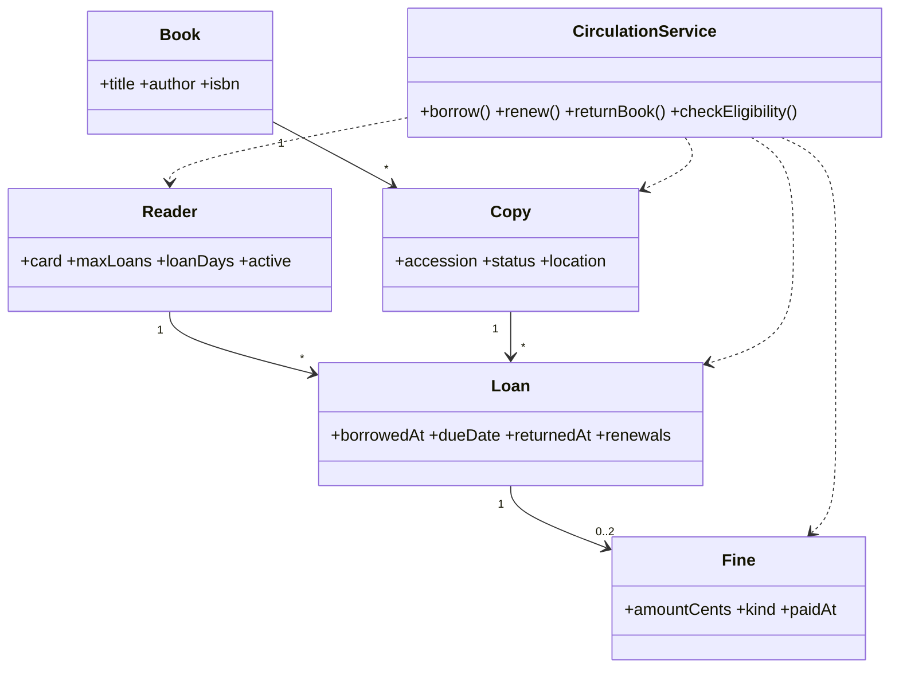
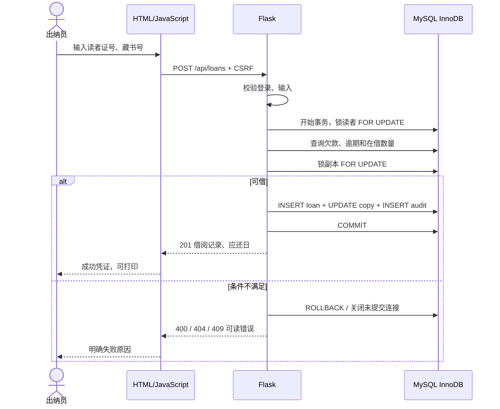
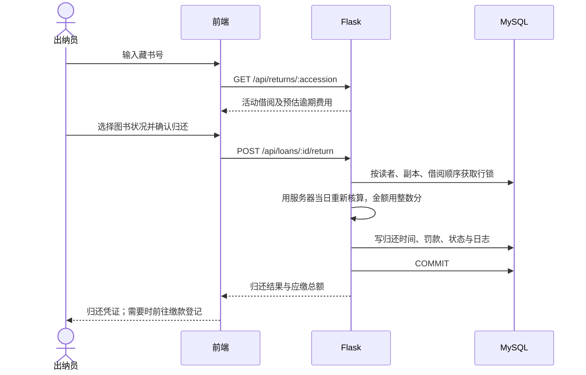
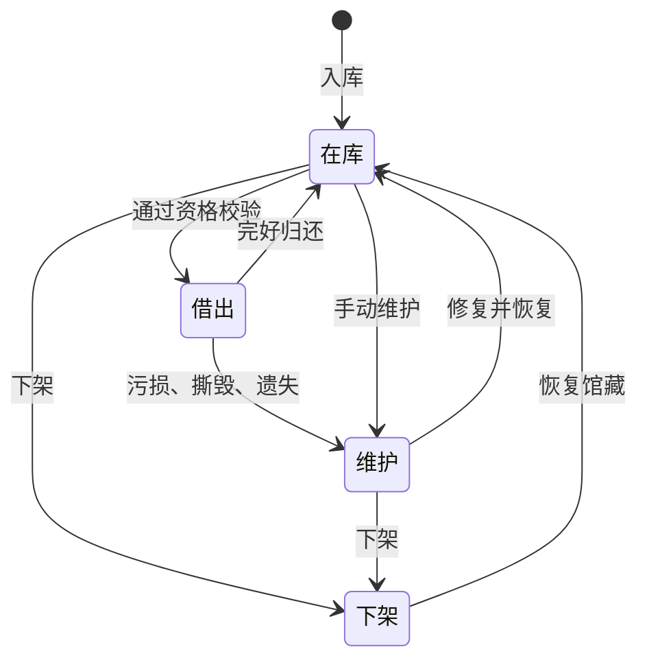
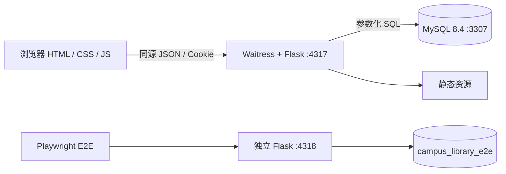

# 系统分析与设计

“信息系统分析与设计”课程项目，小组成员：肖沁峰、邓皓柏。

这份文档是课程要求的分析设计材料：需求、用例图、数据流图、ER 图、类图、时序图和状态图。具体的借阅规则和接口列表在 [设计与验收](设计与验收.md)。

## 1. 要解决什么问题

用纸登记借还，会遇到这些问题：查书慢，借还记录东一本西一本，不知道一本书现在在谁手里，逾期罚款容易算错。PPT 把需求概括成“查、记、追、算”四个字，这个系统就是围绕这四件事做的出纳台。

### 谁用，能做什么

| 角色 | 能做什么 |
| --- | --- |
| 读者 / 访客 | 不用登录，可以查书和每一册的状态。看不到其他读者的信息 |
| 出纳员 | 登录后管理图书和读者，办理借书、还书、续借和缴款登记，查看统计 |

课程版只有这两种角色。需要看统计的管理人员也用出纳员账号登录，没有另外做管理员角色。

### 不做什么

电子书、预约排队、跨馆调书、在线支付、采购和财务、学校统一登录、短信通知。

## 2. 需求和实现的对应关系

| 编号 | 来自 PPT | 需求 | 怎么实现 |
| --- | --- | --- | --- |
| FR-01 | 第 3、4 页 | 输入书名或作者的一部分就能查到，能看到藏书号和状态 | 公开检索页，支持筛选和查看详情 |
| FR-02 | 第 4 页 | 登录，操作要留记录 | 登录会话、CSRF 校验、操作日志表 audit_logs |
| FR-03 | 第 4 页 | 录入、修改、下架、批量导入图书 | 书目表 books 和副本表 copies；CSV 导入要么全部成功，要么全部不保存 |
| FR-04 | 第 4 页 | 读者档案、借书上限、借期 | 读者表 readers；读者证停用或有欠款时不能借书 |
| FR-05 | 第 5 页 | 登记借书，同时改变这一册书的状态 | 依次锁住读者和这一册书，借阅记录和书的状态一起保存 |
| FR-06 | 第 5 页 | 逾期罚款和损坏处理 | 由后端算钱；完好的书回到“在库”，损坏的转为“维护” |
| FR-07 | 第 3 页 | 追踪图书去向 | 按藏书号查借阅历史和当前借阅人 |
| FR-08 | 第 4 页 | 续借 | 没逾期、没欠款，只能续一次 |
| FR-09 | 第 4 页 | 借还和逾期统计 | 近七天趋势、在借比例、逾期排行、CSV 导出 |

其他要求：

- 一台电脑就能演示，电脑和手机上都能用。
- 读者个人信息必须登录才能看。
- 金额以“分”为单位存整数，避免小数误差。
- 用数据库外键和事务保证数据前后一致。
- 检查所有输入；SQL 用参数化查询；用户输入的文字显示到页面前先转义，防止注入。
- 测试用真实浏览器和真实数据库，不用前端假数据代替。

## 3. 用例图

### 主要用例说明

**借书（UC-05）**

- 前提：出纳员已登录。
- 输入：读者证号、藏书号。
- 过程：系统先锁住这位读者的记录，检查读者证有没有停用、有没有欠款、有没有逾期没还的书、借的书有没有到上限；再锁住这一册书，检查它是不是“在库”。
- 成功：生成借阅记录，自动算出应还日期，写一条操作日志，这一册书改成“借出”。
- 失败：返回错误原因，数据不做任何改动。
- 两个人同时借：靠上面的锁，加上“同一册书只能有一条未归还记录”的数据库约束，保证只有一个人能借成功。

**还书（UC-07）**

- 输入藏书号，系统找到这一册还没还的借阅记录。
- 出纳员检查书的状况，页面先显示预计要交多少钱。
- 提交时，系统重新锁住记录，按服务器当天的日期重新算钱，不用前端传来的金额。
- 归还时间、罚款、书的状态、操作日志一起保存。
- 完好的书回到“在库”；污损、撕毁、遗失的转为“维护”。
- 有欠款也能还书。已经还过的再提交会被拒绝。

**续借（UC-06）**

- 条件：这笔借阅还没还；读者证没停用；没有欠款，也没有逾期的书；还没续借过。
- 新的应还日期 = 原应还日期 + 这位读者的借期。系统记录续借次数，写操作日志。
- 已经续过一次、已经还了、或者有逾期的书，都不能续借。

**批量导入（UC-03）**

- 上传 UTF-8 编码的 CSV 文件。前端负责解析（支持带引号的字段），后端逐行检查。
- 只要有一行不合格，或者 ISBN、藏书号重复，整批都不保存。这样不会出现“导了一半”、不知道哪些进去了的情况。

## 4. 数据流图

### 顶层

### 第一层

## 5. ER 图

PPT 里只有三张核心表（读者、借阅记录、图书），我们多拆了几张：

- **书目和副本分开**：一种书可能有好几本，每一本要单独记位置和状态。
- **罚款单独一张表**：方便追踪每一笔钱交了没有。
- **操作日志单独一张表**：记录谁在什么时候做了什么。

核心关系没变，还是“读者—借阅记录—图书”。完整字段和约束以 `schema.sql` 为准。

主要约束：

- ISBN、读者证号、藏书号不能重复。
- 同一册书同时只能有一条未归还的借阅记录。
- 同一笔借阅，同一类罚款最多一条。
- 有借阅历史的书不删除，只改成“下架”。
- 金额不用浮点数存。

## 6. 类图（概念设计）

后端实际是 Flask 的函数式路由，没有写成下面这些 Python 类。这张图只是表示业务对象之间的关系。

## 7. 借书时序图

## 8. 还书时序图和图书状态

一册书的状态变化：

遗失的书不会自动回到“在库”。要等赔偿和补书处理完，再由出纳员手动改状态。

## 9. 架构

- 演示服务跑在 4317 端口，连 3307 端口上的数据库 `campus_library`。
- 测试另起一个 4318 端口的服务，连单独的测试数据库 `campus_library_e2e`，不影响演示数据。

### 事务和加锁

- 数据库隔离级别用 READ COMMITTED。
- 借书、还书、续借都按同一个顺序加锁：先读者，再这一册书，最后借阅记录。缴款也先锁读者。顺序一致，就不会两个请求互相等对方（死锁）。
- 数据库的唯一约束是应用层检查之外的第二道保险。
- 请求出错时不提交，连接关闭后自动回滚。
- 应还日期、逾期天数和金额都由后端算，前端不参与。

### 时间

- 数据库里存北京时间（UTC+8），所有按天算的规则都用这个时间。
- 到期当天还书不收钱，第二天开始收。
- 前端直接显示后端给的日期，不按浏览器所在时区重新换算。

## 10. 测试和限制

- 动手写代码前列出的出错情况在 [设计与验收](设计与验收.md#写代码前列出的出错情况)。
- 测试脚本是 `tests/e2e.cjs`，测试结果以 `artifacts/e2e-results.json` 为准。测试会生成截图和浏览器操作录像（trace），可以回放检查每一步。

这个版本按一所学校、一个图书馆、课程演示的规模做，没做过压力测试，所以不承诺能支撑多少人同时用。

如果要真正上线，还需要：

- 馆藏多了以后：分页、全文检索、给报表加索引；
- 账号方面：账号管理、登录频率限制；
- 部署方面：HTTPS、备份和恢复。

这些都还没做。
